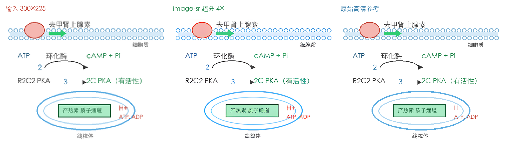

# image-sr

一个给 AI Agent 用的**图像超分辨率 skill**：把低分辨率图片用 [Real-ESRGAN](https://github.com/xinntao/Real-ESRGAN) 在本地放大 4 倍（可选 2 倍），免费、离线、无需任何图像处理网站或 API Key。

专为 [ZCode](https://zcode.ai)、Claude Code 等编码 Agent 设计——当用户说"这张图能不能高清一点""放大这张截图""图太糊了"时，Agent 自动调用本 skill 完成。



*示例：300×225 的模糊小图 → 1200×900 高清输出（文字、线条完整重建）。左侧为低清输入的放大展示，中间为 Real-ESRGAN 输出，右侧为原始高清参考。*

## 特点

- **完全本地**：权重一次性下载（64MB），推理不联网，图片不出本机
- **效果扎实**：Real-ESRGAN x4plus 官方权重，对线条图、图表、文字、截图、图标效果尤其好
- **开箱即用**：一条命令完成环境安装，国内网络自动切换 PyPI / GitHub 镜像
- **大图不崩**：自动分块推理（带重叠消除接缝），内存占用恒定
- **Apple Silicon 加速**：Mac 上自动使用 MPS（Metal），比 CPU 快约 40 倍
- **输出即用**：PNG 输出，默认 300 DPI，可直接插入 PPT / Word / 打印

## 快速开始

```bash
git clone https://github.com/Linwei-Chen/image-sr.git
cd image-sr
bash scripts/setup.sh        # 首次：建 venv + 装 torch + 下权重，约 2-5 分钟

# 超分一张图（默认 4 倍，输出 <原名>_x4.png 到原图目录）
venv/bin/python scripts/sr.py 照片.png
```

## 参数说明

```
venv/bin/python scripts/sr.py <输入图片> [选项]

  -o 路径          输出路径（默认与原图同目录，<原名>_x4.png）
  --scale {2,4}    放大倍数，默认 4（2 倍由 4 倍结果高质量缩小得到）
  --dpi N          输出 DPI，默认 300
  --tile N         分块大小，默认 256；内存不足（大图/8GB 以下内存）时调小到 128
  --cpu            强制 CPU 推理（默认在 Apple Silicon 上自动用 MPS）
  --weights 路径   自定义权重文件（默认 weights/RealESRGAN_x4plus.pth）
```

## 安装为 Agent Skill

### ZCode / Claude Code（用户级，所有项目可用）

```bash
git clone https://github.com/Linwei-Chen/image-sr.git ~/.agents/skills/image-sr
```

重启会话后，Agent 在你要求"放大图片 / 超分 / 变高清"时会自动触发；也可手动 `bash ~/.agents/skills/image-sr/scripts/setup.sh` 预装环境。

### 手动调用（任何有终端的环境）

```bash
bash scripts/setup.sh && venv/bin/python scripts/sr.py input.png
```

## 性能参考

实测（Apple M 系列，MPS 加速）：

| 输入尺寸 | 输出尺寸 | 耗时 |
|---|---|---|
| 128×128 | 512×512 | ~2 秒 |
| 300×225 | 1200×900 | ~2 秒 |
| 751×720 | 3004×2880 | ~3-4 分钟 |

纯 CPU 大约慢 30-40 倍，大图建议耐心等待或缩小 `--tile` 分批跑。

## 常见问题

- **提示找不到权重**：运行 `bash scripts/setup.sh`，权重会下载到 `weights/` 目录（已 gitignore，不会进 git）。
- **国内网络下载慢/失败**：`setup.sh` 会自动重试清华 PyPI 镜像和 gh-proxy 权重镜像；也可手动下载 [RealESRGAN_x4plus.pth](https://github.com/xinntao/Real-ESRGAN/releases/download/v0.1.0/RealESRGAN_x4plus.pth) 放进 `weights/`。
- **JPEG 照片放大后有噪点**：超分会同时放大压缩噪点，属正常现象；对噪点敏感的图可先降噪再超分。
- **人像照片效果一般**：x4plus 是通用模型，人像建议换用官方 [RealESRGAN_x4plus 的 face-restore 分支](https://github.com/xinntao/Real-ESRGAN#portable-executable-files)（如 GFPGAN）。
- **内存不足**：调小 `--tile`（如 128 或 64）。

## 工作原理

`scripts/sr.py` 内置了与官方权重一一对应的 RRDBNet 网络定义（23 个 Residual-in-Residual Dense Block），加载 `RealESRGAN_x4plus.pth` 后纯 PyTorch 推理，无额外依赖（不依赖 basicsr / opencv，只装 torch + pillow + numpy）。大图按 `--tile` 分块、每块向外扩 16px 推理后裁回，保证块间无接缝。

## 致谢

- [Real-ESRGAN](https://github.com/xinntao/Real-ESRGAN)（xinntao）——模型与权重，BSD-3-Clause 许可
- 本仓库的代码在其官方权重的文件格式基础上简化实现，仅作轻量封装

## License

MIT © 2026 [Linwei-Chen](https://github.com/Linwei-Chen)（模型权重遵循其原许可 BSD-3-Clause）
